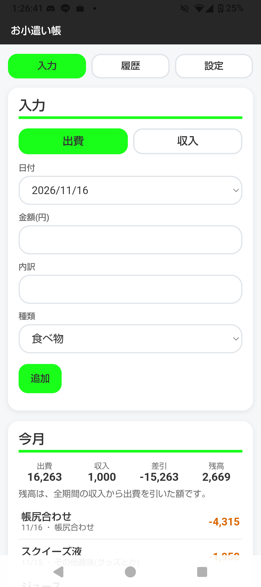
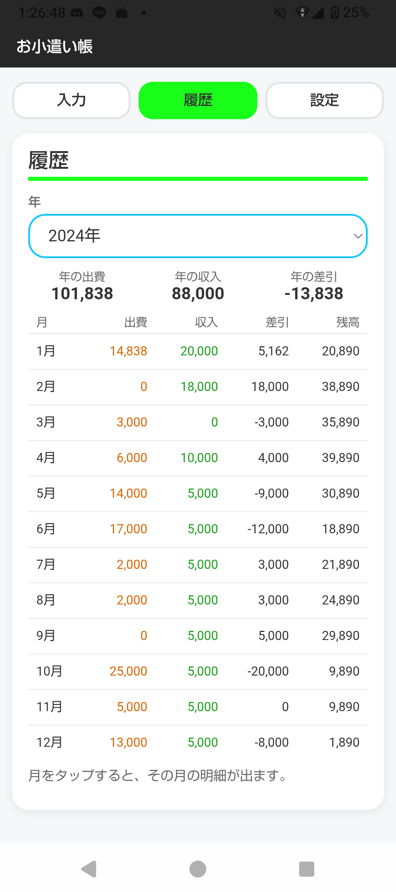
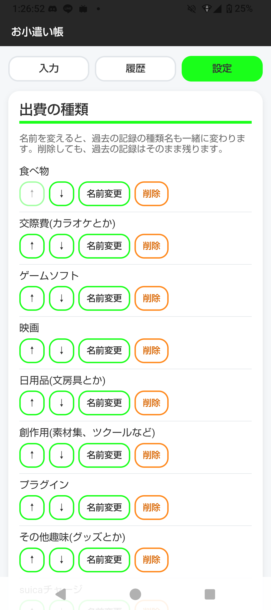

# 概要

　自分用のお小遣い帳アプリです  
　機能も自分用です

# 各画面
## 入力

　出費・収入を入力します  
　下には今月の履歴が表示されます

  

 

## 履歴

　各年の収支や履歴を確認できます

  

 

## 設定

　出費の種類、収入の種類を追加、編集できます  
　下のxlsx取り込みは、かつて自分が使っていたお小遣い帳ファイルを取り込むためのものです

  

 